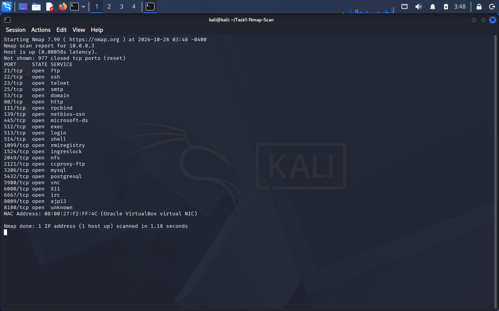
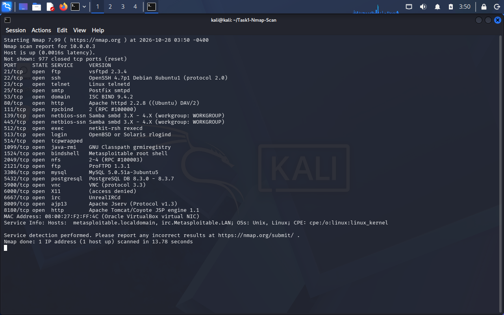
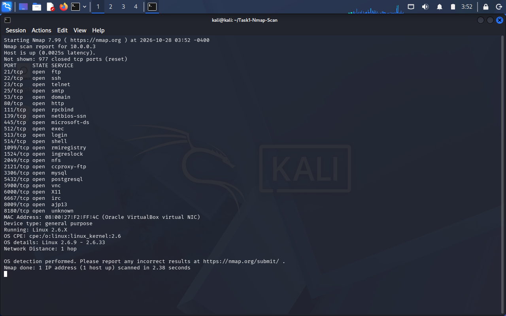
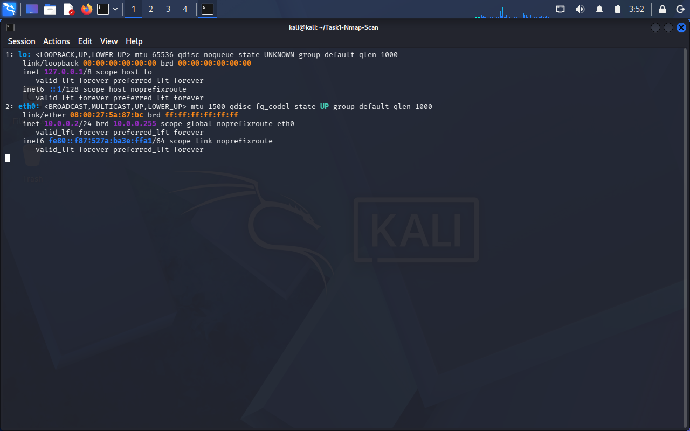

# Task 1: Basic Network Scanning with Nmap

## Overview
This task uses Nmap to scan a local virtual machine, identify open ports and
running services, detect the operating system, and analyse the security risk
of each open port.

- **Scanner:** Kali Linux VM (10.0.0.2)
- **Target:** Metasploitable2 VM (10.0.0.3), an intentionally vulnerable training VM
- **Network:** Isolated VirtualBox NAT Network (10.0.0.0/24)
- **Tool:** Nmap 7.99

## What is Nmap?
Nmap ("Network Mapper") is a free, open-source tool for network discovery and
security auditing. It sends specially crafted packets to a target and analyses
the replies to find out:
- which hosts are online
- which ports are open
- which services and versions are running
- which operating system the host uses

## Why Network Scanning Matters
- **Know your attack surface:** every open port is a possible way in. You cannot protect what you do not know about.
- **Find outdated or vulnerable software:** version detection shows software with known vulnerabilities.
- **Detect misconfigurations:** unnecessary or insecure services (such as Telnet or exposed databases) can be found and closed.
- **Support audits and defence:** regular scanning is part of vulnerability management and penetration testing.

## Ethical Use Guidelines
- Only scan systems you **own** or have **explicit written permission** to test.
- Scanning other people's networks without permission can be illegal (for example under computer misuse laws) even if no damage is done.
- Use an isolated lab environment, as done here. Never scan external or production systems.
- Do not use findings to attack or disrupt a system.
- Report any vulnerabilities you find responsibly.

## Installing Nmap
Nmap comes pre-installed on Kali Linux. To check:
```bash
nmap --version
```
If it is missing, or on Ubuntu/Debian:
```bash
sudo apt update
sudo apt install nmap -y
nmap --version
```
On Windows, download the installer from https://nmap.org/download.html and
run it, then use Nmap from PowerShell.

## Lab Setup
1. Both VMs (Kali and Metasploitable2) are attached to the same VirtualBox NAT Network.
2. Metasploitable2 IP found with `ifconfig`: **10.0.0.3**
3. Kali IP checked with `ip a`: **10.0.0.2**
4. Connectivity verified with `ping -c 4 10.0.0.3` (0% packet loss).

## Scans Performed
| Scan | Command | Purpose |
|---|---|---|
| Basic scan | `nmap 10.0.0.3` | Find open ports (top 1000 TCP) |
| Version scan | `nmap -sV 10.0.0.3` | Identify service names and versions |
| OS detection | `sudo nmap -O 10.0.0.3` | Guess the target operating system |

## Key Findings
- **Host:** 10.0.0.3 is up, with **23 open TCP ports** (977 closed).
- **OS:** Linux 2.6.9 - 2.6.33 (a very old kernel).
- **Critical risks:** vsftpd 2.3.4 backdoor (21), root bindshell (1524), UnrealIRCd backdoor (6667).
- **High risks:** Telnet, r-services (512-514), Samba, NFS, exposed databases, VNC, Tomcat.
- Most services are outdated and several send data unencrypted.

The full port-by-port analysis (what each service does and its security risk)
is in [`nmap_scan_results.txt`](nmap_scan_results.txt).

## Recommendations
- Close every port that is not needed.
- Replace Telnet, FTP and r-services with SSH/SFTP.
- Patch or upgrade all outdated software.
- Bind databases to localhost only and use strong passwords.
- Use a firewall to restrict access.

## Screenshots
**Nmap install check and lab connectivity**


**Basic scan**


**Service version scan**


**OS detection scan**


**Target VM network configuration**


## Files in this Repository
- `README.md`: this document
- `nmap_scan_results.txt`: raw scan results and port-by-port security analysis
- `basic_scan.txt`, `version_scan.txt`, `os_scan.txt`: raw output of each scan
- `screenshots/`: terminal screenshots

## References
- Nmap documentation: https://nmap.org/docs.html
]
- Kali Linux: https://www.kali.org/get-kali
