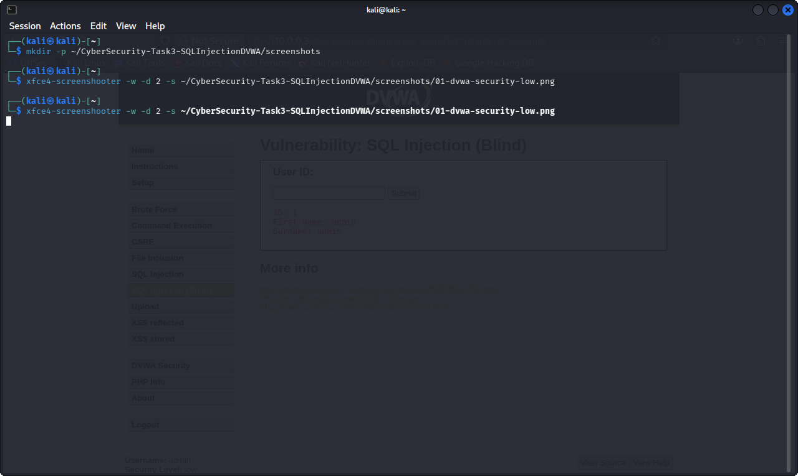
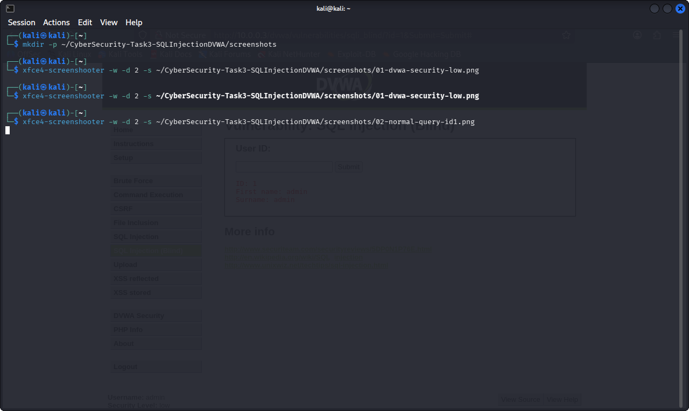
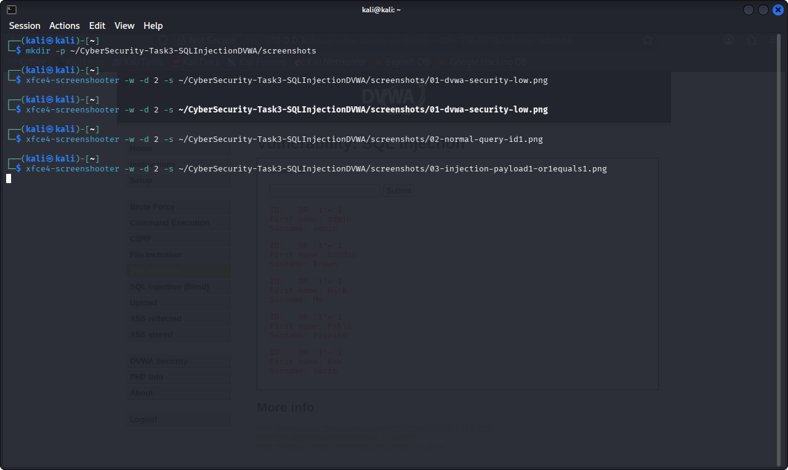
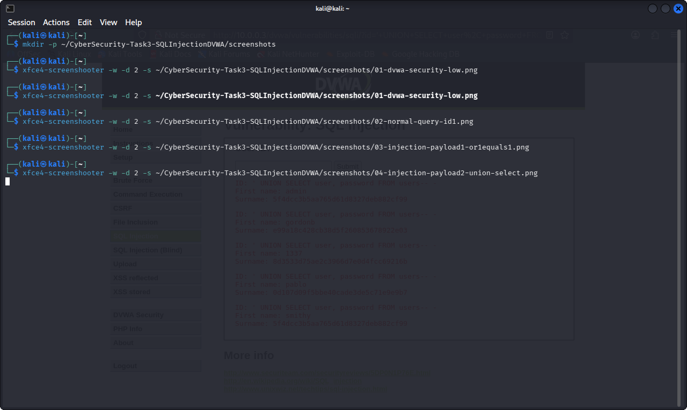

# Task 3: SQL Injection on DVWA (Low Security)

## Environment
- Target: DVWA (Damn Vulnerable Web Application), pre-installed on the
  Metasploitable2 VM (10.0.0.3), accessed from a Kali Linux browser
- URL: 10.0.0.3/dvwa/vulnerabilities/sqli/
- Security level set to Low via DVWA Security page
- Login: admin / password (DVWA default)

## What is SQL Injection?
SQL Injection is a vulnerability where user input is inserted directly
into a database query without being checked or escaped. If an attacker
can control part of that input, they can change the structure of the
query itself, not just the value it searches for. This can let them
read data they should not see, bypass logins, or in some cases modify
or delete data.

## Why these payloads work
DVWA (Low) builds its query by joining the user's input straight into
a SQL string, roughly:
  SELECT first_name, last_name FROM users WHERE user_id = '$id';
No escaping or validation is applied to $id.

- ' OR '1'='1 closes the quote early and adds a condition that is
  always true, so the WHERE clause matches every row instead of one.
- ' UNION SELECT user, password FROM users-- - attaches a second
  query onto the first one, pulling columns from a completely
  different table (users), and comments out the rest of the original
  query so it still runs without a syntax error.

## What data was exposed
- Test 1 (baseline, ID=1): one user's name
- Test 2 (' OR '1'='1): all 5 users in the table
- Test 3 (UNION SELECT): usernames and MD5 password hashes for every
  DVWA account

Full payload log and analysis: [sql_injection_notes.md](sql_injection_notes.md)

## How a developer would fix this
Use parameterised queries (prepared statements) instead of building
SQL strings by hand. For example in PHP with PDO:
  $stmt = $pdo->prepare("SELECT first_name, last_name FROM users WHERE user_id = ?");
  $stmt->execute([$id]);

With a prepared statement, the input is sent to the database
separately from the query structure. The database treats it purely as
a value to match, never as part of the SQL itself, so a quote or a
UNION keyword typed into the field can no longer change what the
query does.

Other good practices: least-privilege database accounts, input
validation, and not showing raw database errors to users.

## Ethics
This test was performed only against DVWA running locally in my own
isolated VM lab. No external or production system was targeted.

## Screenshots

